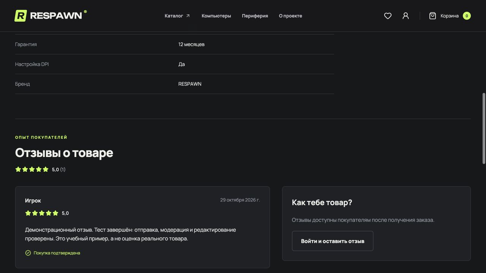

<p align="center"></p>

# RESPAWN


Демонстрационный интернет-магазин оборудования для игрового пространства. Клавиатуры, мыши, кресла и компьютеры, тёмный интерфейс с неоновой подсветкой и полный путь от каталога до заказа.

Проект для портфолио и изучения full-stack разработки. **Оплата имитируется. Реальные деньги не списываются, товары не отправляются.**

## Что работает

- Адаптивный лендинг, собственные SVG-иллюстрации, анимация и поддержка уменьшенного движения.
- Каталог: категории, поиск по названию/бренду/артикулу, сортировка, цена, наличие, пагинация.
- Страница товара, характеристики, другие товары категории.
- Отзывы подтверждённых покупателей, оценки от 1 до 5, средний рейтинг и количество отзывов в каталоге.
- Избранное и корзина с восстановлением после перезагрузки.
- Регистрация, вход, выход, изменение имени и пароля.
- Оформление заказа с доставкой или самовывозом, расчётом стоимости на сервере.
- История заказов, просмотр деталей, отмена до передачи в доставку.
- Админка: добавление, редактирование и скрытие товаров, остатки, характеристики, обработка заказов и модерация отзывов.
- Серверная проверка прав, CSRF, ограничение частоты запросов, транзакции и защита от повторного оформления.

В начальном каталоге 24 товара: 23 опубликованы, один скрыт; один опубликованный товар не в наличии. Все названия, описания и изображения демонстрационные.

## Стек

PHP 8.5 в контейнере, Laravel 13, MySQL 8.4, Vue 3, Vue Router, Pinia, Axios, Tailwind CSS 4, Vite, Laravel Sail, PHPUnit, Node.js Test Runner, Prettier, Laravel Pint.

Точные версии закреплены в `composer.lock` и `package-lock.json`. Шрифты Manrope и Unbounded установлены локально через Fontsource. Иконки Lucide. Приложение не загружает шрифты или изображения с внешних сервисов.

## Первый запуск через Docker

Нужен работающий Docker Desktop с Docker Compose. Выполнять команды из корня **этого** проекта.

1. Создать локальные настройки. Существующий `.env` не перезаписывать:

   ```bash
   test -f .env || cp .env.example .env
   ```

2. Установить PHP-зависимости. Если PHP 8.5 и Composer уже установлены, достаточно `composer install`. Без локального PHP:

   ```bash
   docker run --rm \
     -u "$(id -u):$(id -g)" \
     -v "$PWD":/var/www/html \
     -w /var/www/html \
     laravelsail/php84-composer:latest \
     composer install --ignore-platform-reqs
   ```

   Этот одноразовый контейнер нужен только для первоначальной установки `vendor`, включая Sail. Требования рабочего PHP проверяются внутри Sail следующим шагом. Не используйте `--ignore-platform-reqs` при установке зависимостей на рабочем сервере.

3. Запустить контейнеры, дождаться базы и подготовить приложение:

   ```bash
   ./vendor/bin/sail up -d --wait
   ./vendor/bin/sail composer check-platform-reqs
   ./vendor/bin/sail artisan key:generate
   ./vendor/bin/sail artisan migrate
   ./vendor/bin/sail artisan db:seed
   ./vendor/bin/sail artisan shop:demo-accounts
   ./vendor/bin/sail npm ci
   ./vendor/bin/sail npm run build
   ```

4. Открыть [http://localhost](http://localhost).

`key:generate` нужен при первом запуске с пустым `APP_KEY`. Не меняйте ключ уже используемого приложения. `db:seed` создаёт или обновляет демонстрационный каталог по slug, включая цены и остатки. Он не предназначен для регулярного запуска поверх вручную отредактированного каталога.

Все дальнейшие Composer, PHP и npm-команды запускайте через Sail. Не смешивайте установку npm-зависимостей на Mac и внутри Linux-контейнера: у сборщика есть платформенные пакеты.

Порты по умолчанию: сайт 80, MySQL 3306, Vite 5173. Если они заняты другим проектом, остановите его либо измените `APP_PORT`, `FORWARD_DB_PORT`, `VITE_PORT` и соответствующий `APP_URL` в локальном `.env`.

Официальная справка: [Laravel Sail](https://laravel.com/framework/docs/13.x/sail).

## Демо-аккаунты

Создаются командой `shop:demo-accounts` только в окружении `local` или `testing`. Повторный запуск не меняет существующие аккаунты.

| Роль | Почта | Пароль |
| --- | --- | --- |
| Покупатель | buyer@respawn.test | RespawnDemo2026! |
| Администратор | admin@respawn.test | RespawnDemo2026! |

Публичные демонстрационные пароли предназначены только для локального просмотра. Для сервера создайте собственного администратора:

```bash
php artisan shop:create-admin admin@example.com --name="Администратор"
```

Команда интерактивно запросит пароль. Она не перезаписывает и не повышает права существующего пользователя. Параметр `--password` есть для автоматических тестов; для рабочего пароля используйте интерактивный ввод.

Админка: `/admin`. В кабинете администратора также есть ссылка на неё.

## Обновление существующей установки

После получения изменений примените новые миграции и пересоберите интерфейс:

```bash
./vendor/bin/sail artisan migrate
./vendor/bin/sail npm run build
```

Для отзывов добавлена таблица `reviews`. Миграция не меняет существующие товары и заказы. Повторный запуск сидера для этого обновления не нужен. Демонстрационные отзывы автоматически не создаются.

## Ежедневная работа

```bash
./vendor/bin/sail up -d
./vendor/bin/sail npm run dev
```

Vite работает в текущем терминале. Для просмотра готовой сборки:

```bash
# Сначала остановить npm run dev через Ctrl+C.
./vendor/bin/sail npm run build
```

Если после аварийной остановки Vite остался `public/hot`, а сервер разработки больше не запущен, удалите только этот служебный файл. Затем обновите страницу. Файл не хранится в Git.

Остановить контейнеры с сохранением данных:

```bash
./vendor/bin/sail stop
```

`down -v` удаляет том базы. Для обычной остановки он не нужен.

## Проверки

```bash
./vendor/bin/sail artisan test --compact
./vendor/bin/sail npm test
./vendor/bin/sail npm run format:check
./vendor/bin/sail npm run build
./vendor/bin/sail composer audit
./vendor/bin/sail npm audit
```

PHPUnit принудительно использует SQLite `:memory:`. Основная MySQL-база в этих тестах не очищается. Проверяются каталог, права, сессии, создание и отмена заказа, доставка, подмена цены, повторные запросы, нехватка товара, скрытые позиции и административные команды. Для отзывов проверяются право после получения товара, ограничения полей, уникальность, публикация и отклонение, редактирование, конфликты версий, пагинация, приватность и расчёт рейтинга.

Node.js проверяет корзину, изменившиеся остатки и цены, избранное, повреждённое хранилище и безопасный возврат после входа.

CI в GitHub Actions запускает PHP-тесты, JS-тесты, проверку форматирования и сборку. Браузерный прогон выполнен вручную; автоматических браузерных тестов в проекте пока нет.

Форматирование:

```bash
./vendor/bin/sail bin pint --dirty --format agent
./vendor/bin/sail npm run format
```


Проверка 29.10.2026 после добавления отзывов: 30 PHP-тестов (197 проверок), 7 JS-тестов, форматирование и production-сборка проходят. Миграция отзывов применена в локальной MySQL 8.4. Через браузер проверен полный цикл от получения демо-заказа до публикации, отклонения и повторного редактирования отзыва. Настольная и мобильная вёрстка проверены, на ширине 390 px горизонтального переполнения нет. Стрелки обычных селекторов расположены с отступом 14 px от правого края.

До добавления отзывов установка зависимостей, миграции, сидер, 23 PHP-теста и сборка были повторены из чистого Git-снимка в одноразовом контейнере Sail PHP 8.5 с отдельной SQLite-базой. Контейнер использовал уже собранный образ Sail; сборка самого Docker-образа с нуля в этот прогон не входила. Этот отдельный прогон чистой установки после добавления отзывов не повторялся.

## Кодстайл

Настройки кодстайла хранятся в `pint.json`, `.prettierrc.json` и `.editorconfig`.

PHP: 4 пробела, пробелы вокруг конкатенации, без пробела после `!`, приведения типа и `fn`. Массивы бизнес-данных и ветки `match` оформляются вертикально, длинные цепочки запросов разбиваются по методам. Короткие списки правил валидации допустимы в строке. Логические блоки разделяются пустыми строками.

Vue и JavaScript: сохраняются смысловые переносы; атрибуты тегов размещаются отдельно, импорты и объекты используют компактные фигурные скобки. Ориентир длины строки 110 символов. Сгенерированные файлы и зависимости не форматируются.

Pint и Prettier настроены под эти правила. Проверка в CI выявляет расхождения; смысловое разбиение кода дополнительно проверяется при ревью. Изменения оформления встроены в исходные тематические коммиты, без отдельного коммита с форматированием.

## Как устроено оформление

1. В браузере сохраняются только идентификаторы товаров и количество. Пароли, сессионные токены и контактные данные заказа в localStorage не записываются.
2. Перед оформлением браузер получает актуальные товары и настройки доставки.
3. `CheckoutRequest` проверяет состав и контакты, `CheckoutService` заново считает стоимость по базе.
4. В транзакции блокируется строка покупателя и строки товаров в порядке их ID. Это защищает остатки при одновременных заказах и повторных запросах.
5. У каждой попытки есть UUID. Уникальный индекс `user_id + idempotency_key` и отпечаток запроса позволяют вернуть прежний заказ при повторе; изменение данных с тем же ключом отклоняется.
6. Названия, артикулы, количества и цены копируются в `order_items`. Последующее изменение каталога не меняет историю.
7. При отмене статус и остатки меняются в одной транзакции. Повторная отмена не возвращает товар второй раз.

Все суммы в базе и API хранятся в **целых копейках**. В админской форме цена вводится в рублях. Доставка стоит 490 ₽, бесплатна от 15 000 ₽; самовывоз бесплатен. Эти правила находятся в `config/shop.php` и отдаются интерфейсу через `GET /api/shop`.

Статусы: `processing → shipped → completed`. Из `processing` возможна отмена `cancelled`. После передачи в доставку отмена покупателем запрещена.

## Отзывы и рейтинг



- Отзыв может оставить вошедший покупатель, у которого есть заказ с этим товаром в статусе `completed` (получен). Заказ в обработке, в доставке или отменённый не даёт этого права.
- Один покупатель оставляет один отзыв на товар. Оценка от 1 до 5, текст от 10 до 2000 символов. Повторные покупки не создают дополнительные отзывы.
- Новый отзыв получает статус `pending`. Администратор публикует его (`approved`) или отклоняет (`rejected`), обязательно указав причину. Причина видна автору и администратору.
- Покупатель может изменить свой отзыв. Изменённая версия снова ожидает модерации и временно не участвует в публичном рейтинге. Повторная отправка тех же данных не создаёт дубликат и не снимает публикацию.
- В каталоге и на странице товара учитываются только опубликованные отзывы. Без них выводится «Пока нет отзывов», а не нулевая оценка. Список загружается по 5 отзывов на страницу; административный список по 12.
- Публично показывается только первое слово имени покупателя, без почты и других контактных данных. Низкая оценка сама по себе не является причиной отклонения.
- Уникальный индекс и транзакции защищают от дубликатов. Поле `revision` не позволяет старой вкладке перезаписать более новую редакцию или опубликовать уже изменённый текст. При конфликте сервер возвращает HTTP 409.
- Рейтинг и количество считаются агрегатами в запросе каталога, без отдельного запроса для каждого товара. Поддельных отзывов в сидере нет.

Для ручной проверки оформите демо-заказ покупателем, последовательно переведите его в админке до статуса «Получен» и откройте товар. После отправки отзыва он появится во вкладке «Отзывы» админки. На скриншоте показан явно обозначенный учебный отзыв из локального браузерного прогона; в новых установках его нет.

## Организация кода

| Область | Где смотреть |
| --- | --- |
| Публичный каталог | `ProductController`, `CategoryController`, API Resources |
| Вход и профиль | `AuthController`, `stores/auth.js` |
| Заказы и остатки | `CheckoutService`, `OrderController`, `Order`, `OrderItem` |
| Отзывы и модерация | `Review`, `ReviewController`, `Admin/ReviewController`, `ReviewResource`, `ReviewTest` |
| Интерфейс отзывов | `ProductReviews.vue`, `RatingStars.vue`, `AdminReviews.vue` |
| Административные права | `EnsureAdmin`, контроллеры `Admin` |
| Страницы | `resources/js/pages` |
| Переиспользуемые элементы | `resources/js/components` |
| Корзина и избранное | `resources/js/stores` |
| Внешний вид | `resources/css/app.css`, `public/images/products` |
| Проверки | `tests/Feature`, `tests/Frontend` |

SPA и API работают на одном домене. Используются стандартные Laravel-сессии, HttpOnly cookie и CSRF, без JWT в хранилище браузера. Маршруты записей защищены сервером, а не только Vue Router. Чужие заказы возвращают 404. Гость не может оформить заказ, обычный покупатель не может открыть административный API.

Запросы каталога пагинированы и заранее загружают категории. При смене фильтров устаревший запрос отменяется. Страницы Vue загружаются отдельными частями; админка не включена в начальную загрузку покупателя.

## Основные API

| Метод и путь | Назначение |
| --- | --- |
| `GET /api/categories` | Категории с количеством опубликованных товаров |
| `GET /api/products` | Каталог с фильтрами и пагинацией |
| `GET /api/products/{slug}` | Опубликованный товар с рейтингом |
| `GET /api/products/{slug}/reviews` | Опубликованные отзывы и сводный рейтинг |
| `GET /api/products/{slug}/review` | Свой отзыв и право его оставить |
| `PUT /api/products/{slug}/review` | Создание или изменение своего отзыва с `revision` |
| `GET /api/session` | Пользователь и CSRF-токен |
| `POST /api/register`, `/api/login`, `/api/logout` | Сессия пользователя |
| `PATCH /api/profile`, `PUT /api/password` | Имя и пароль |
| `GET /api/orders`, `GET /api/orders/{number}` | Свои заказы |
| `POST /api/orders` | Оформление с `idempotency_key` |
| `POST /api/orders/{number}/cancel` | Отмена своего заказа |
| `GET /api/admin/summary` | Сводка магазина |
| `GET/POST /api/admin/products` | Список и создание товара |
| `PUT/DELETE /api/admin/products/{id}` | Изменение или скрытие товара |
| `GET /api/admin/orders` | Все заказы |
| `PATCH /api/admin/orders/{id}` | Изменение статуса |
| `GET /api/admin/reviews` | Отзывы с фильтром по статусу и пагинацией |
| `PATCH /api/admin/reviews/{id}` | Публикация или отклонение с `revision` |

Ошибки полей возвращаются с HTTP 422, отсутствие входа с 401, отсутствие административных прав с 403. Отсутствующие JS-файлы и API-маршруты не заменяются HTML-страницей приложения.

## Что проверено в браузере

Каталог и пагинация; категории и сортировка; поиск; избранное; добавление в корзину; вход с возвратом к оформлению; расчёт доставки; создание демо-заказа; очистка корзины; история; отмена; просмотр заказа администратором; сохранение товара; мобильная и настольная вёрстка.

Отзывы: недоступность формы до получения товара; отправка; публикация; отклонение с причиной; повторное редактирование и публикация; изменение рейтинга; отсутствие дубликатов; гостевой вид; отображение оценки в каталоге; мобильная компоновка. На всех обычных селекторах проверен отступ стрелки справа.

Дополнительные сценарии для самостоятельного знакомства:
- попробовать заказать товар с нулевым остатком;
- войти покупателем и открыть `/admin`;
- скрыть товар в админке и открыть его старую ссылку;
- оформить заказ и последовательно изменить его статусы;
- обновить страницу каталога с фильтрами в адресе.

## Перед публикацией

В Git нет `.env`, `vendor`, `node_modules`, сборки, дампов и локальной базы. Схема, сидеры, исходники, lock-файлы и инструкции включены.

Репозиторий ещё не привязан к удалённому GitHub-адресу. После создания своего репозитория:

```bash
git remote add origin <адрес-вашего-репозитория>
git push -u origin HEAD
```

Изменения разделены на коммиты каталога, авторизации, заказов, админки, витрины, проверок и документации. Исходная история учебного проекта сохранена.

## Границы демонстрационного проекта

Реального эквайринга, фискализации, отправки писем, интеграций доставки, подтверждения почты и восстановления забытого пароля пока нет. Категории задаются сидером; в админке можно выбирать существующую категорию. Для изображений используется четыре собственные иллюстрации, загрузки фотографий нет.

Для коммерческого запуска нужны реальные товары и политики магазина, интеграция платежей и доставки, почта, резервное копирование, мониторинг, HTTPS и настройки production. Публичные демо-аккаунты нельзя использовать на рабочем сервере. Режим оплаты сейчас всегда демонстрационный, простой смены переменной окружения недостаточно для реального приёма денег.

На сервере запускайте приложение через PHP-FPM и веб-сервер с корнем `public/`; Sail предназначен для разработки. Используйте `APP_ENV=production`, `APP_DEBUG=false`, корректный HTTPS `APP_URL`, `SESSION_SECURE_COOKIE=true`, отдельные секреты и БД. Сборку собирайте перед переключением релиза. Чтобы открытые вкладки могли догрузить прежние JS-части, не удаляйте предыдущие файлы сборки сразу при развёртывании.
